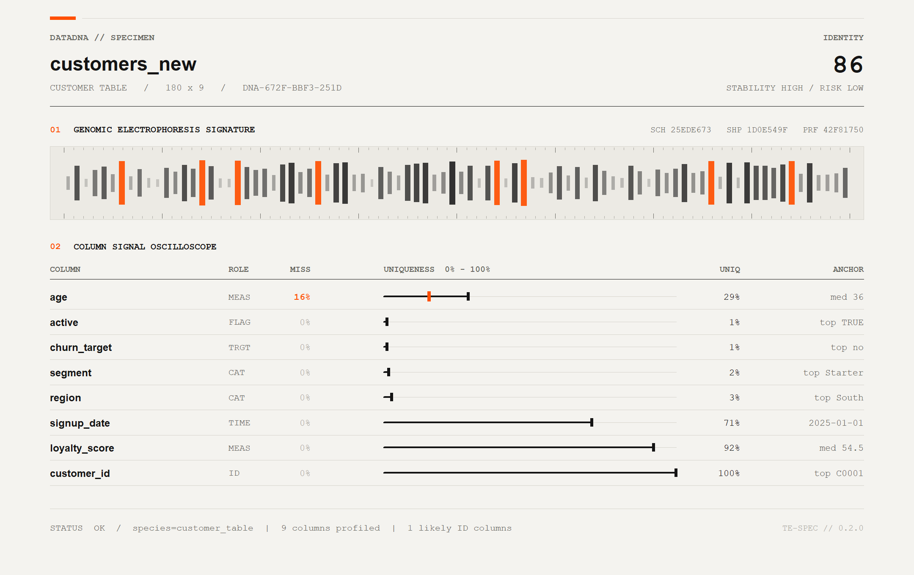
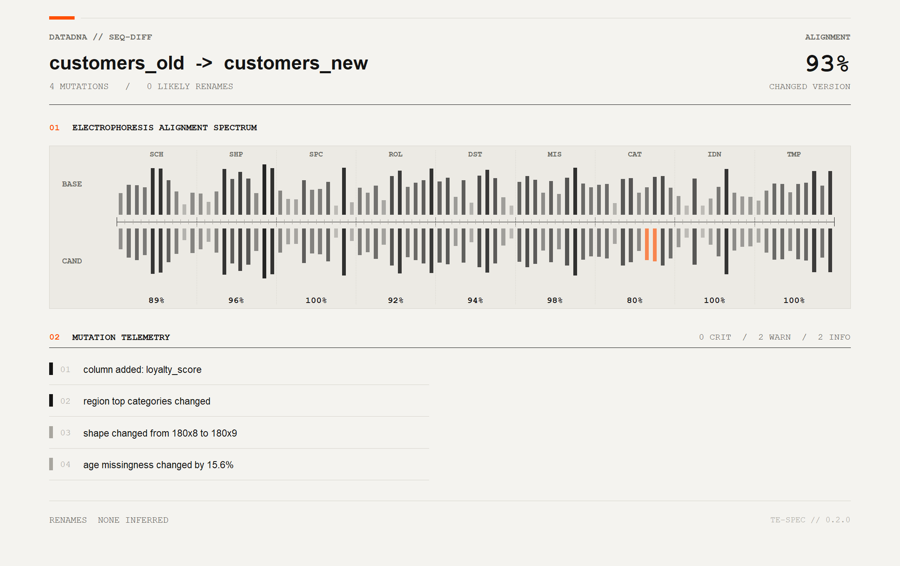
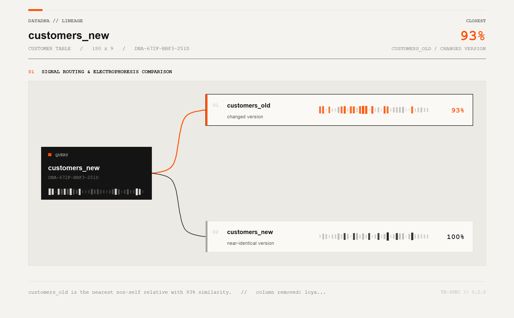

<div align="center">
<h1>DataDNA</h1>
<p><strong>Give every table a fingerprint. Catch drift before it breaks downstream work.</strong></p>
<p>Zero-dependency R package for compact data fingerprints, drift diagnosis, lineage matching, and precision report figures.</p>
<p>
  <a href="https://github.com/TonyIsFool/DataDNA/actions/workflows/R-CMD-check.yaml"></a>
  
  
  <a href="LICENSE"></a>
</p>
<p><a href="#download-and-install"></a></p>
<p><a href="#quick-start">Quick Start</a> | <a href="#drift-and-lineage">Drift &amp; Lineage</a> | <a href="#batch-libraries">Batch Libraries</a> | <a href="#api-reference">API Reference</a> | <a href="#contact">Contact</a></p>
</div>

**`data.frame` -> compact fingerprint -> drift &amp; lineage -> static figure &amp; interactive HTML card.**

DataDNA profiles R data frames using pure base R (`R >= 4.1.0`): **0 external package dependencies,
no runtime JavaScript CDN, and no raw rows retained** in saved fingerprint libraries. Instead of only
asking *"what is in this table?"*, it answers what kind of dataset it is, how stable its identity is,
what shifted between versions, and which historical snapshot it evolved from.

| What DataDNA computes | What you get |
| --- | --- |
| Schema, shape, and statistical profile hashes | Compact `data_dna` specimen ID and species label |
| Rename inference, numeric, category, and temporal drift | Ranked `dna_diff()` mutations and 9-dimension scores |
| Streaming directory or list profiling (`dna_library()`) | Lightweight `.rds` libraries and `dna_match()` lineage |
| Base `grid` graphics and self-contained HTML5/SVG | Print-ready `.png` / `.pdf` / `.svg` figures and interactive cards |

## Coverage & Design

### Built for Recurring Tables. Zero External Dependencies.

| **0** | **9** | **4** |
| :---: | :---: | :---: |
| External R package dependencies | Fingerprint comparison dimensions | Output formats (HTML, PNG, PDF, SVG) |

**Precision diagnostics, light footprint.** DataDNA separates schema identity from statistical drift
so analysts and automated pipelines can recognize recurring warehouse extracts, CSV drops, and
modeling tables without keeping full historical tables in memory.

| Dimension | Signal tracked |
| --- | --- |
| Schema &amp; Renames | Column overlap, type changes, and likely renamed columns (`cust_id -> customer_id`) |
| Shape &amp; Species | Row/column proportions and inferred table archetype (`customer_table`, `event_stream`, ...) |
| Role Structure | Column roles (`id`, `time`, `measure`, `category`, `flag`, `text`, `target`) |
| Distribution &amp; Missingness | Spread-aware numeric quantile shifts, uniqueness changes, and `NA` rate deltas |
| Category &amp; Temporal | Top-level category drift and date/timestamp window coverage shifts |

## Download And Install

**R 4.1 or later, with a writable R library.** Only base R packages (`grDevices`, `grid`, `stats`, `tools`, `utils`) are required.

```r
install.packages("remotes")
remotes::install_github("TonyIsFool/DataDNA")
```

<details>
<summary>Install from a downloaded ZIP or local source archive</summary>

1. On this GitHub repository, select **Code &gt; Download ZIP** and extract it.
2. Point `source_dir` to the folder containing **DESCRIPTION**, or install the built `.tar.gz` from [Releases](https://github.com/TonyIsFool/DataDNA/releases):

```r
# From extracted source directory
install.packages("path/to/extracted/DataDNA", repos = NULL, type = "source")

# Or from a built source tarball
install.packages("DataDNA_0.2.0.tar.gz", repos = NULL, type = "source")
```

</details>

## Quick Start

Profile a bundled customer table without preparing your own file:

```r
library(DataDNA)

demo <- dna_example_customers()

# 1. Profile a single data frame
dna <- data_dna(demo$customers_new, name = "customers_new")
dna
summary(dna)

# 2. Render a static specimen figure (.png / .pdf / .svg) or interactive HTML card
dna_plot(dna, file = "customers_profile.png")
dna_card(dna, file = "customers_dna.html")
```



## Drift And Lineage

Compare two versions of a dataset to score 9 fingerprint dimensions, detect likely column renames,
and inspect ranked drift mutations:

```r
dna_compare(demo$customers_old, demo$customers_new)
dna_diff(demo$customers_old, demo$customers_new)

# Render a dual-lane electrophoresis drift figure
dna_diff_plot(demo$customers_old, demo$customers_new, file = "drift_report.png")
```



## Batch Libraries

Build a lightweight fingerprint library from a list of tables or directly from a directory of
`.csv`, `.tsv`, `.rds`, and `.rda` files. Raw tables are profiled one by one and not retained in memory:

```r
lib <- dna_library(list(
  customers_2024 = demo$customers_old,
  customers_2025 = demo$customers_new
))

match <- dna_match(demo$customers_new, lib)
match

# Render static lineage topology (.png / .pdf / .svg) or interactive HTML report
dna_match_plot(match, file = "lineage.png")
dna_match_card(match, file = "lineage.html")
```



## API Reference

<details>
<summary>Core functions and S3 methods</summary>

| Function | Purpose |
| --- | --- |
| `data_dna(x)` / `dna_species(x)` | Profile a data frame into a `data_dna` fingerprint and infer table species |
| `dna_compare(x, y)` / `dna_diff(x, y)` | Compute 9-dimension similarity scores, rename inference, and ranked mutations |
| `dna_library(x, file)` | Stream-profile a list or directory of tables and optionally save `.rds` |
| `dna_match(x, library)` | Match a query dataset against a `dna_library` or named list of candidates |
| `dna_plot(x, file)` | Export a static specimen electrophoresis &amp; signal figure (`.png`, `.pdf`, `.svg`) |
| `dna_diff_plot(x, y, file)` | Export a static dual-lane electrophoresis drift report (`.png`, `.pdf`, `.svg`) |
| `dna_match_plot(match, file)` | Export a static lineage routing &amp; electrophoresis figure (`.png`, `.pdf`, `.svg`) |
| `dna_card(x, file)` / `dna_match_card(match, file)` | Render a self-contained interactive HTML5/SVG instrument card (light/dark mode) |
| `summary()`, `plot()`, `as.data.frame()`, `print()` | Standard S3 generics across `data_dna`, `dna_comparison`, `dna_diff`, `dna_library`, `dna_match` |

</details>

## Contact

Have a dataset or drift workflow you would like DataDNA to support? Feel free to email
**Tony Lu** at [xulunt123@gmail.com](mailto:xulunt123@gmail.com) anytime, or open an issue on
[GitHub](https://github.com/TonyIsFool/DataDNA/issues).
